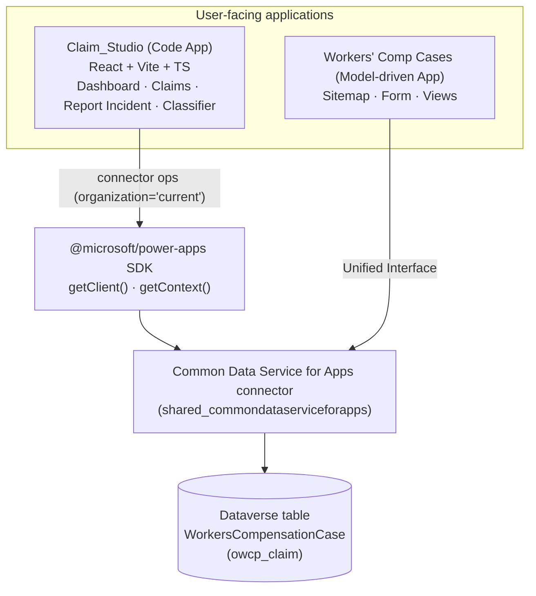
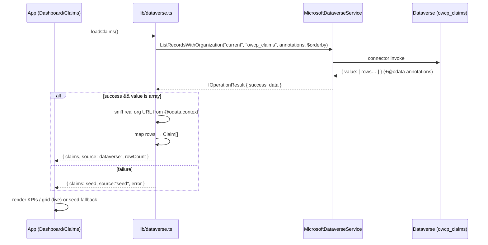
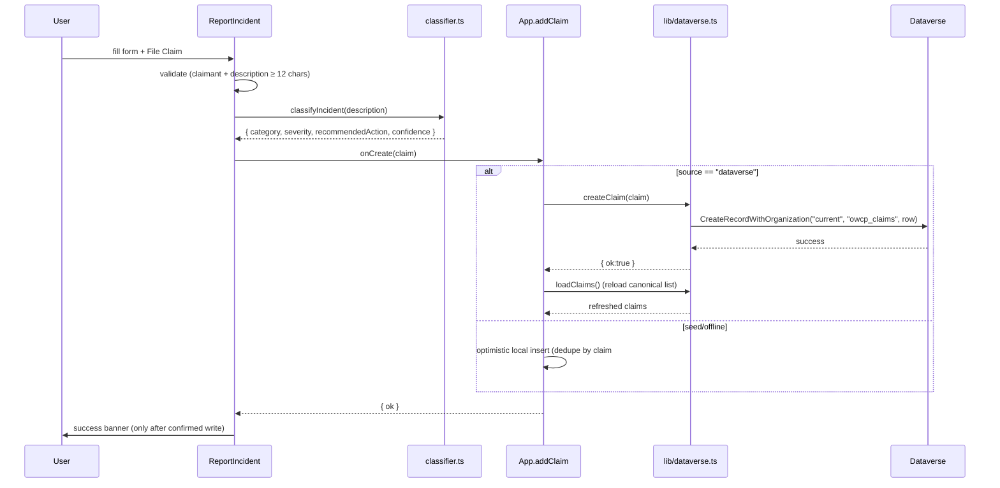
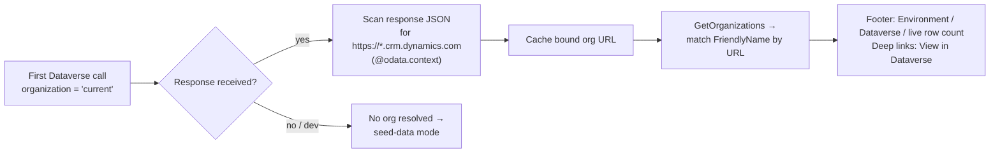
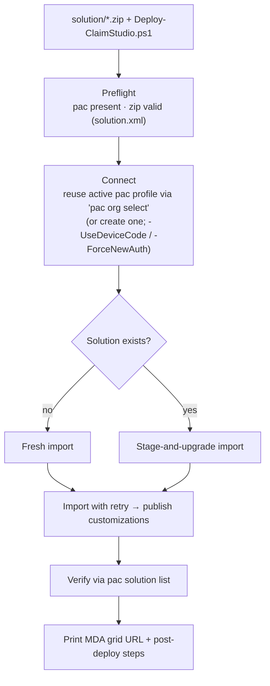
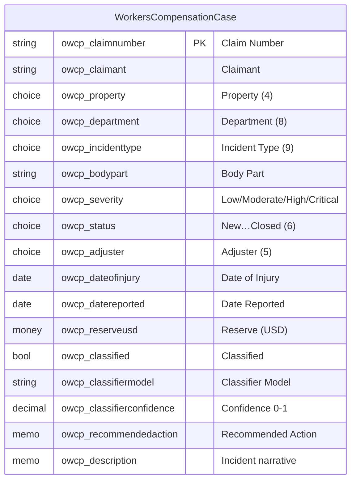

# ClaimsAssist — Claim_Studio

**Workers' Compensation Case Management** for the Flagship Location Resorts legal & risk team.

Claim_Studio is a Microsoft Power Platform solution that lets adjusters intake workplace
incidents, auto-classify them, track case status and financial reserves, and analyze
claim trends across properties — all backed by a live Microsoft Dataverse table.

| | |
|---|---|
| **App** | Claim_Studio (Power Apps **Code App** — React + Vite + TypeScript) |
| **Admin app** | Workers' Comp Cases (**model-driven app**, `dystudio_wccases`) |
| **Table** | WorkersCompensationCase (logical `owcp_claim`, set `owcp_claims`) |
| **Primary column** | Claim Number (`owcp_claimnumber`) |
| **SDK** | `@microsoft/power-apps` (Dataverse connector client) |
| **Solution** | `ClaimStudio` (managed + unmanaged zips in `solution/`) |

> The application contains **no hard-coded environment values**. The bound Dataverse
> organization is resolved at runtime, so the same build runs unchanged in any
> environment the solution is deployed to.

---

## Repository layout

```
.
├── src/                       # Code app source (React + TS)
│   ├── App.tsx                # Shell, nav, metadata-driven footer
│   ├── components/            # Dashboard, Claims, ReportIncident, Classifier, ui
│   ├── lib/
│   │   ├── dataverse.ts       # Data layer (runtime org resolution, CRUD)
│   │   └── classifier.ts      # Deterministic incident classifier (Copilot Studio stand-in)
│   ├── data/seed.ts           # Types + offline seed data
│   └── generated/             # Generated Dataverse service (pac code)
├── .power/                    # Power Platform app schema (data source info)
├── solution/
│   ├── ClaimStudio_managed.zip      # Managed solution (deploy to test/prod)
│   ├── ClaimStudio_unmanaged.zip    # Unmanaged solution (dev)
│   └── Deploy-ClaimStudio.ps1       # Hardened deployment script
├── OWCP_Claim.schema.json     # Canonical table/column definitions
├── Claim_Studio-Wiki.html      # Single-file solution wiki
├── Claim_Studio-Spec.docx      # Functional & data specification
├── power.config.json          # pac code push target (dev-only pointer)
└── package.json / vite.config.ts / tsconfig*.json
```

---

## Architecture



- **Host bridge** — the SDK establishes a message-channel bridge to the Power Apps player host.
- **Context** — `getContext()` returns environment id, tenant id, and signed-in user.
- **Data client** — `getClient(dataSourcesInfo)` + the generated `MicrosoftDataverseService`
  wrap each connector operation.
- **Connection** — calls use the connector's `"current"` organization alias, which always
  resolves to the org the connection is bound to.

---

## Data flow — loading claims (read)



Key guarantees:
- Every call checks `result.success`; a connector failure is surfaced as an error, never
  silently shown as an empty table.
- A live connection with **zero rows** is reported as `Dataverse (live · 0 rows)`, not a fallback.
- Outside the Power host (local `npm run dev`), calls fail fast and the UI uses bundled seed data.

---

## Data flow — filing a claim (write)



- Choice (option-set) labels are mapped to numeric values (`100000000 + index`) on write.
- The success banner appears **only after Dataverse confirms** the write; failures show an error.

---

## Runtime organization resolution (no hard-coded env values)



- Data operations always target the bound org via the `"current"` alias.
- The **real** org URL (for deep links and the footer) is discovered by scanning the
  Dataverse response payload — nothing is baked into the build.
- Solution identifiers that are intentionally portable (the model-driven app name
  `dystudio_wccases`, table `owcp_claim`) are the same in every environment.

---

## Deployment flow



### Deploy to a new environment

```powershell
# Production / test (managed)
.\solution\Deploy-ClaimStudio.ps1 -EnvironmentUrl https://contoso.crm.dynamics.com

# Development (unmanaged)
.\solution\Deploy-ClaimStudio.ps1 -EnvironmentUrl https://dev.crm.dynamics.com `
    -SolutionZip .\solution\ClaimStudio_unmanaged.zip -Managed:$false

# Headless / no browser
.\solution\Deploy-ClaimStudio.ps1 -EnvironmentUrl https://contoso.crm.dynamics.com -UseDeviceCode

# Force a fresh sign-in instead of reusing the active pac profile
.\solution\Deploy-ClaimStudio.ps1 -EnvironmentUrl https://contoso.crm.dynamics.com -ForceNewAuth
```

The script is hardened: input + zip validation, auth reuse (no forced prompt), fresh-vs-upgrade
detection, import retry, publish, and post-import verification. It parses under both
PowerShell 7 and Windows PowerShell 5.1. Verified cross-environment (darbotlabs → test).

---

## Data model — WorkersCompensationCase



Choice option values are allocated sequentially from `100000000` in the order documented in
`OWCP_Claim.schema.json`. The app maps display labels to those values on write and uses
Dataverse formatted-value annotations on read.

---

## Develop locally

```bash
npm install
npm run dev      # http://localhost:3000 (uses bundled seed data outside the Power host)
npm run build    # tsc + vite build
pac code push    # publish a new version (target set in power.config.json)
```

> `power.config.json` points `pac code push` at the authoring environment during
> development. It is **not** part of the shipped solution; update it per developer / pipeline.

---

## Screens

| Screen | Purpose |
|---|---|
| **Dashboard** | KPI cards (total/open/reserve/AI-classified), Recent Claims, Status & Incident-type breakdowns, with drill-through to filtered Claims. |
| **Claims** | Searchable/filterable register; detail drawer; **View in Dataverse** (table grid + per-record). |
| **Report Incident** | Structured intake with live validation, classifier preview, and confirmed write to Dataverse. |
| **Incident Classifier** | Interactive classifier mirroring the Copilot Studio workflow (category, severity, recommended action). |

See `Claim_Studio-Wiki.html` for the full solution wiki and `Claim_Studio-Spec.docx` for the
functional & data specification.

---

## Roadmap

- Replace the deterministic classifier with the live Copilot Studio classification workflow.
- Add edit/disposition actions (Status, Reserve, Adjuster) from the Claims detail drawer.
- PDF claim summary generated and attached on filing (File column scaffolding exists on the table).
- Server-side paging for large case volumes.
- Leadership dashboards/charts in the model-driven app.
